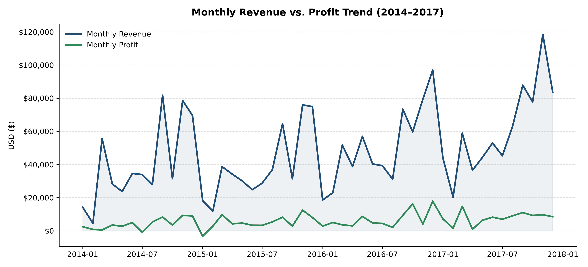
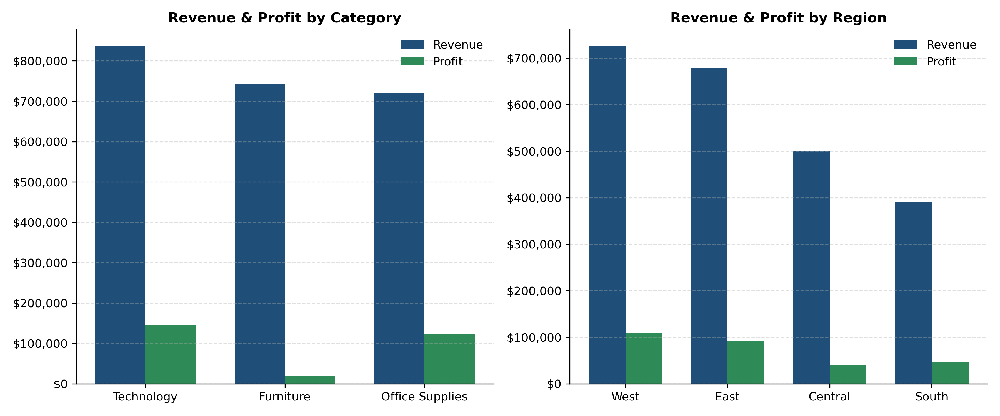
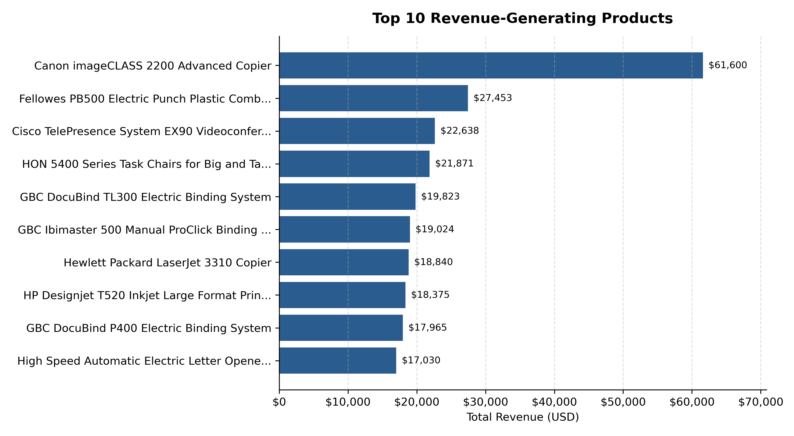
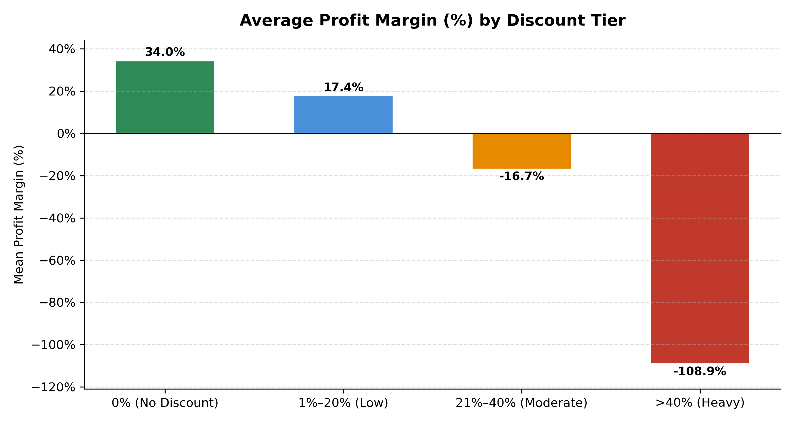

# Business Sales Performance Analytics (`FUTURE_DS_01`)

**Track:** Data Science & Analytics — Task 1 (Future Interns)  
**Author:** Casebar Mkhari | BSc Applied Mathematics & Statistics 
**Tools Used:** Python (`Pandas`, `NumPy`, `Matplotlib`, `Seaborn`, `Statsmodels`), Jupyter Notebook, MS Excel  

---

## 1. Executive Summary & Business Problem
To support strategic revenue growth and margin optimization, this project analyzes **9,994 retail transactions** across **5,009 unique orders** and **793 customers** from the Superstore Sales dataset (2014–2017). The objective is to identify key revenue drivers, evaluate regional and category-level profitability, diagnose loss-making product lines, and quantify the financial impact of discounting on net profit margins.

### Core Key Performance Indicators (KPIs)
| Metric | Value |
| :--- | :--- |
| **Total Revenue** | **$2,297,200.86** |
| **Total Net Profit** | **$286,397.02** |
| **Overall Profit Margin** | **12.47%** |
| **Total Unique Orders** | **5,009** |
| **Total Active Customers** | **793** |
| **Average Order Value (AOV)** | **$458.61** |

---

## 2. Key Analytical Findings

### A. Revenue Trends & Seasonality
* Sales exhibit strong upward year-over-year growth accompanied by recurring **Q4 seasonal surges** (peaking between September and December each year).
* While revenue scales sharply in Q4, net profit does not always grow proportionally due to aggressive promotional discounting during peak holiday months.



### B. Category & Regional Performance
* **Technology** is the top-performing category, generating **$836,154.03** in revenue (**36.4%** of total sales) and **$145,454.95** in profit at a **17.40%** margin.
* **Office Supplies** delivers strong volume (**22,906 units**) and **$122,490.80** in profit (**17.04%** margin).
* **Furniture** generates **$741,999.80** in revenue—surpassing Office Supplies in top-line sales—but yields only **$18,451.27** in profit (**2.49%** margin), dragged down by severe losses in **Tables (-$17,725.48)** and **Bookcases (-$3,472.56)**.
* **Regional Leaders vs. Laggards:** The **West** region leads in both revenue (**$725,457.82**) and profit margin (**14.94%**), followed by the **East** (**$678,781.24**, **13.48%** margin). **Central** underperforms significantly with a **7.92%** profit margin despite generating **$501,239.89** in revenue.



### C. Top-Selling Products & Loss-Making Sub-Categories
* Revenue at the product level is heavily driven by high-ticket Technology items (such as the *Canon imageCLASS 2200 Advanced Copier*).
* Conversely, three sub-categories operate at a cumulative net loss across the dataset:
  1. **Tables:** `-$17,725.48` loss on `$206,965.53` sales
  2. **Bookcases:** `-$3,472.56` loss on `$114,880.00` sales
  3. **Supplies:** `-$1,189.10` loss on `$46,673.54` sales



### D. Statistical Discount Impact Analysis (OLS Regression)
An Ordinary Least Squares (OLS) regression modeling **Profit Margin (%)** against **Discount Rate** confirms a statistically significant inverse relationship ($R^2 = 0.7473$, $p < 0.001$):
* **Baseline Margin (0% Discount):** **42.56%**
* **Marginal Sensitivity:** Every **+10% increase in discount** erodes profit margin by **19.54 percentage points**.
* Discounts exceeding **20%** consistently push transactions into negative profitability.



---

## 3. Actionable Business Recommendations
1. **Cap Promotional Discounts at 20%:** Establish automated approval thresholds for discounts above 20%. Redirect promotional budgets toward value-added bundling (e.g., pairing high-margin Office Supplies with Technology hardware) rather than deep price cuts.
2. **Restructure Pricing & Fulfillment for Tables and Bookcases:** Conduct a unit-economics audit on **Tables** (`-$17.7K` loss) and **Bookcases** (`-$3.5K` loss). Adjust minimum order quantities, renegotiate freight/shipping rates, or phase out unprofitable SKUs in high-discount territories.
3. **Audit Discounting Practices in the Central Region:** Investigate why the **Central** region converts `$501.2K` in sales at half the profit margin (**7.92%**) of the **West** (**14.94%**), and replicate the West's pricing governance across Central accounts.
4. **Scale Inventory Ahead of Q4 Peak Demand:** Align procurement and working capital ahead of the September–December surge in Technology and Office Supplies to maximize full-margin fulfillment during peak buying windows.

---

## 4. Repository Structure
```text
FUTURE_DS_01/
├── data/
│   └── superstore_sales_cleaned.csv        # Cleaned & feature-engineered dataset
├── notebooks/
│   └── sales_performance_analysis.ipynb    # Python EDA, OLS regression & chart generation
├── visuals/
│   ├── 01_monthly_revenue_profit_trend.png
│   ├── 02_category_regional_performance.png
│   ├── 03_top_10_products_revenue.png
│   └── 04_discount_vs_profit_margin.png
└── README.md                               # Executive report & recommendations
